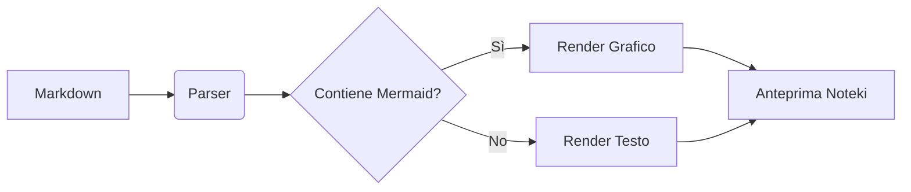

# La mia prima nota

Questo è un semplice paragrafo per verificare il rendering
del Markdown nella mia applicazione.

## Formattazione

Questo testo è **in grassetto**.

Questo testo è *in corsivo*.

Questo è ***grassetto e corsivo***.

Questo testo è ~~barrato~~.

Questo è `codice inline`.

---

## Liste

### Lista puntata

- Primo elemento
- Secondo elemento
  - Sottoelemento A
  - Sottoelemento B
- Terzo elemento

### Lista numerata

1. Aprire l'app
2. Creare una nota
3. Scrivere del Markdown
4. Controllare il rendering

### Checklist

- [x] Supporto ai titoli
- [x] Supporto al grassetto
- [ ] Supporto alle tabelle
- [ ] Supporto alle immagini

## Citazioni

> Questa è una citazione.
>
> Può contenere anche **testo formattato**.

## Blocchi di codice

```swift
struct Note {
    let title: String
    let content: String
}

print("Hello, Markdown!")
```

## Tabelle

| Nome | Tipo | Stato |
| :--- | :---: | ---: |
| Markdown | Testo | OK |
| Swift | Codice | OK |
| Immagini | Media | TODO |

## Link

Visita [GitHub](https://github.com).

## Immagini
![[noteki.png]]

## Grafico Mermaid



## Formule LaTeX

Formula nel testo: l'area del cerchio è $A = \pi r^2$ e l'energia è $E = mc^2$.

Con indici e frazioni: $x_{1,2} = \frac{-b \pm \sqrt{b^2 - 4ac}}{2a}$.

Blocco su una riga:

$$\sum_{n=1}^{\infty} \frac{1}{n^2} = \frac{\pi^2}{6}$$

Blocco su più righe:

$$
\int_0^1 x^2\,dx = \left[ \frac{x^3}{3} \right]_0^1 = \frac{1}{3}
$$

Matrice:

$$
\begin{pmatrix} a & b \\ c & d \end{pmatrix}
\begin{pmatrix} x \\ y \end{pmatrix}
=
\begin{pmatrix} ax + by \\ cx + dy \end{pmatrix}
$$

Da non trasformare: costa $5 e $10, un dollaro scritto \$ e il codice `$x$`.

Formula sbagliata (deve apparire in rosso): $\frac{1}{$.

## Ultimo test

Un paragrafo con **grassetto**, *corsivo*,
`codice inline` e [un link](https://example.com)
tutti nella stessa frase.

---

Fine del documento.

