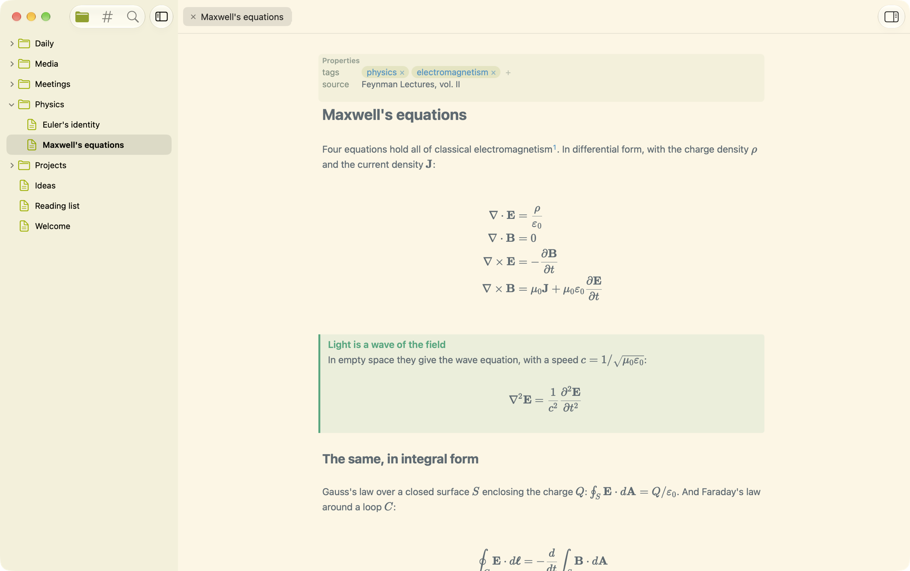
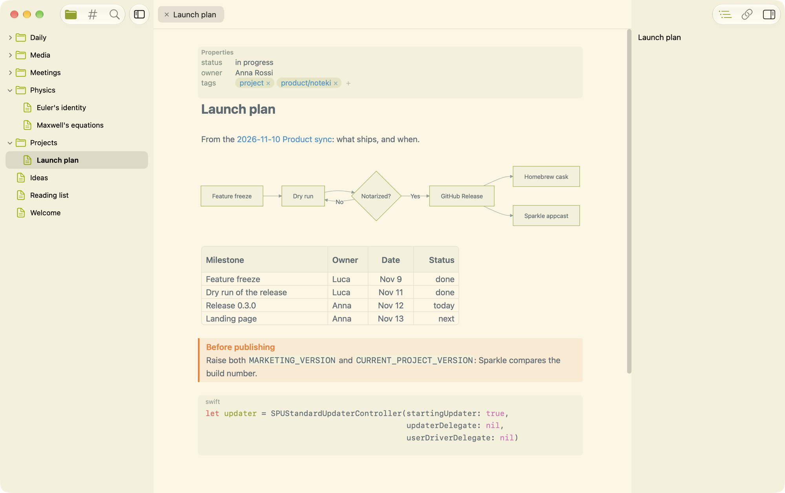
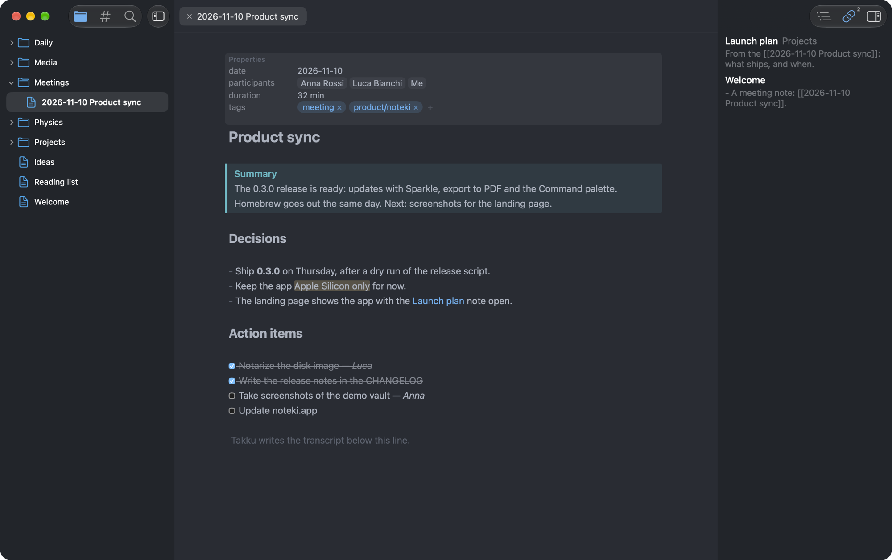
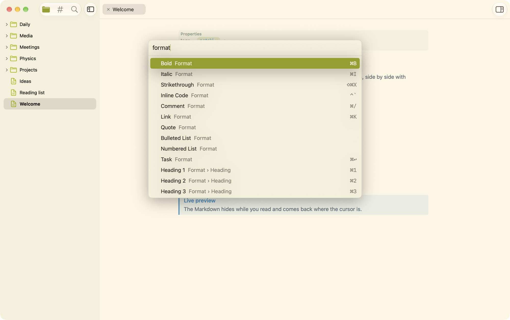

<p align="center">
  
</p>

<h1 align="center">Noteki</h1>

<p align="center">macOS 15+ · Apple Silicon</p>

<p align="center"><a href="https://noteki.app">noteki.app</a> · <a href="https://github.com/mameli/Noteki/releases/latest/download/Noteki.dmg">Download</a> · <a href="CHANGELOG.md">What's new</a></p>

A light native Mac app to read and write the Markdown vault you keep with **Obsidian**, a fraction of its weight. It works on the same files, side by side with Obsidian, and keeps the parts used every day.

<p align="center">
  
</p>

- **Live preview**: the Markdown syntax hides and shows again where the cursor is; formulas drawn with KaTeX, Mermaid diagrams, tables edited cell by cell, callouts, task lists, footnotes, code coloured in its language, images in the text.
- **Frontmatter** shown as a Properties table, with Tags as chips.
- **Wikilinks** resolved as Obsidian does, completed as you type, with **Backlinks** and an Outline in the sidebar.
- **Tags** pane, **Search** across the vault, a Quick switcher, the Daily note, and a **Command palette** (⇧⌘P) with every command.
- **Paste** from the web, Mail or Word as Markdown; **export** a note to HTML or PDF, or print it.
- **External changes** merged while you type: written for the Meeting notes [Takku](https://github.com/mameli/Takku) writes during a call.
- **Updates itself**, and installs with Homebrew: `brew tap mameli/noteki && brew trust mameli/noteki && brew install --cask noteki`.

<table>
  <tr>
    <td></td>
    <td></td>
  </tr>
  <tr>
    <td align="center">Mermaid, tables, callouts and code</td>
    <td align="center">A meeting note, in One Dark Pro, with its Backlinks</td>
  </tr>
  <tr>
    <td></td>
    <td valign="middle">The <b>Command palette</b> (⇧⌘P) finds every command of the menus by name, with its shortcut.<br><br>The notes in these pictures are in <a href="docs/demo-vault">docs/demo-vault</a>: open it as a vault to try Noteki.</td>
  </tr>
</table>

## Build

Requires Xcode with Swift 6. The editor (CodeMirror 6, in `Editor/`) is committed already built in `Noteki/Resources/editor.html`, so the app builds without Node.

```sh
xcodebuild -project Noteki.xcodeproj -scheme Noteki -configuration Release -derivedDataPath build.noindex/Release build
```

To sign with your Developer ID, copy `Config/Local.xcconfig.example` to `Config/Local.xcconfig` and set your team. After changing the editor's sources, run `npm install && npm run build` in `Editor/`; `npm test` runs its tests.

## Docs

The specification is in [docs/SPEC.md](docs/SPEC.md), the vocabulary in [CONTEXT.md](CONTEXT.md) and the decisions in [docs/adr](docs/adr/). Code borrowed from other projects is listed in [THIRD_PARTY.md](THIRD_PARTY.md).

## License

[MIT](LICENSE)
