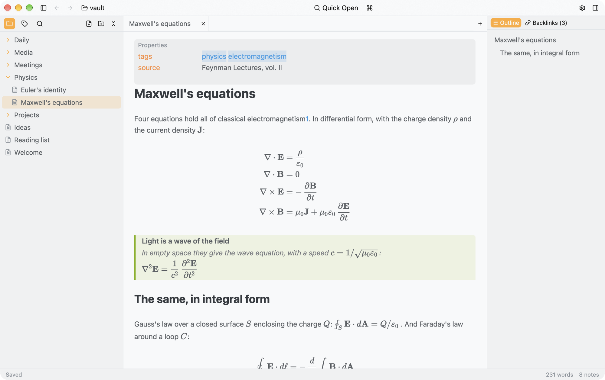
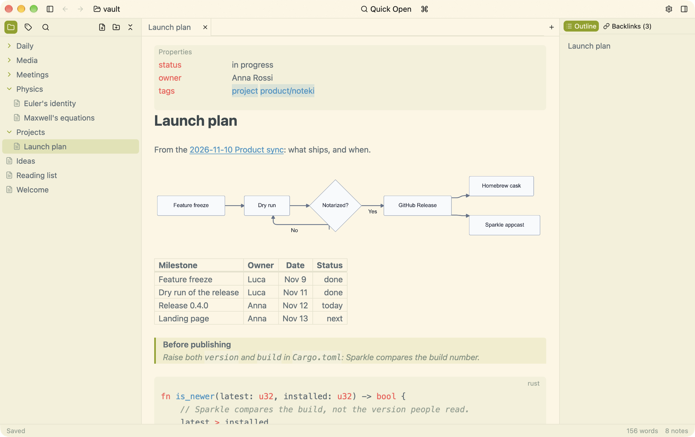
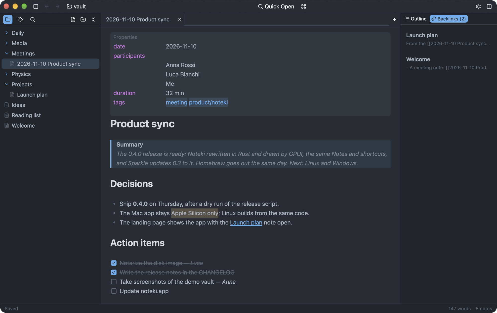
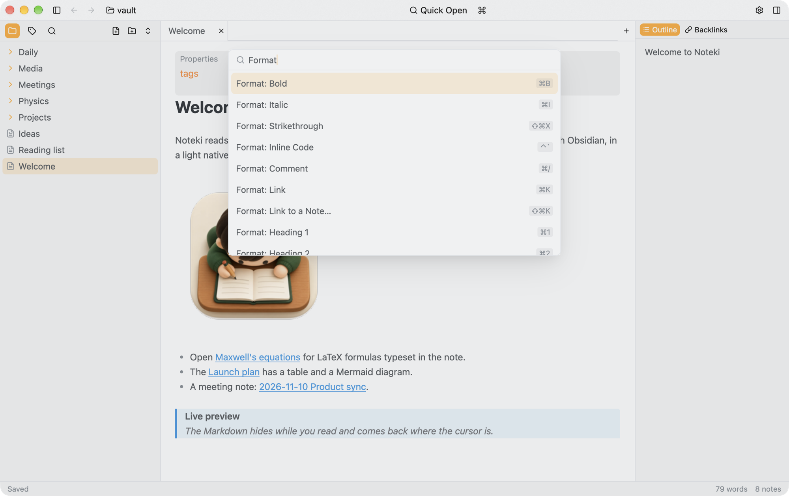

<p align="center">
  
</p>

<h1 align="center">Noteki</h1>

<p align="center">macOS 15+ on Apple Silicon · Linux and Windows on the way</p>

<p align="center"><a href="https://noteki.app">noteki.app</a> · <a href="https://github.com/mameli/Noteki/releases/latest/download/Noteki.dmg">Download</a> · <a href="CHANGELOG.md">What's new</a></p>

A light native app to read and write the Markdown vault you keep with **Obsidian**, a fraction of its weight. It works on the same files, side by side with Obsidian, and keeps the parts used every day. Written in Rust, drawn by [GPUI](https://www.gpui.rs): no web page inside.

The Mac app is out. The same code builds on Linux, and Windows is next: both are still being tried out.

<p align="center">
  
</p>

- **Live preview**: the Markdown syntax hides and shows again where the cursor is; LaTeX formulas typeset and Mermaid diagrams drawn in the note, tables edited cell by cell, callouts, task lists, footnotes, code coloured in its language, images in the text.
- **Frontmatter** shown as a Properties table, with Tags as chips.
- **Wikilinks** resolved as Obsidian does, completed as you type, with **Backlinks** and an Outline in the sidebar.
- **Tags** pane, **Search** across the vault, a Quick switcher, the Daily note, and a **Command palette** (⇧⌘P) with every command.
- **Paste** from the web, Mail or Word as Markdown; **export** a note to HTML or PDF, or print it.
- **External changes** merged while you type: written for the Meeting notes [Takku](https://github.com/mameli/Takku) writes during a call.
- **Updates itself**, and installs with Homebrew: `brew tap mameli/noteki && brew trust mameli/noteki && brew install --cask noteki`.

<table>
  <tr>
    <td></td>
    <td></td>
  </tr>
  <tr>
    <td align="center">Mermaid, tables, callouts and code</td>
    <td align="center">A meeting note, in One Dark Pro, with its Backlinks</td>
  </tr>
  <tr>
    <td></td>
    <td valign="middle">The <b>Command palette</b> (⇧⌘P) finds every command of the menus by name, with its shortcut.<br><br>The notes in these pictures are in <a href="docs/demo-vault">docs/demo-vault</a>: open it as a vault to try Noteki.</td>
  </tr>
</table>

Up to 0.3 Noteki was a SwiftUI app with a CodeMirror editor in a web view: its code is in the history and in the [0.3.1 release](https://github.com/mameli/Noteki/releases/tag/v0.3.1).

## Support

Noteki is free and open source, and it will stay that way. If it is useful to you, you can [support its development](https://buy.stripe.com/6oU5kCeuudcFeoIeac6wE05). It works exactly the same whether you do or not.

## Build

Requires Rust (stable).

```sh
cargo run                      # opens the last vault, or docs/demo-vault
scripts/bundle.sh              # target/release/Noteki.app, signed ad hoc
scripts/eval.sh                # every check, report in target/eval-report.md
```

`NOTEKI_VAULT=/path/to/vault` opens another vault. `NOTEKI_SETTINGS=/tmp/s.json` uses another preferences file (the default is `~/Library/Application Support/Noteki/gpui-settings.json`; the first launch without it takes the preferences of Noteki 0.3).

### The Mac app

`scripts/bundle.sh` builds `target/release/Noteki.app`: bundle id `app.noteki.noteki`, its icon and document types, and Sparkle 2.10.1 for updates. `scripts/release.sh --dry-run` builds it signed with the Developer ID, notarized, in its disk image, with the appcast; without `--dry-run` it then publishes the GitHub Release and the Homebrew cask, after asking. The version is `version` in `Cargo.toml`, the build number Sparkle compares `[package.metadata.noteki] build`.

### Linux

The same app, built on Linux (Wayland or X11): `scripts/package-linux.sh` makes `target/release/noteki-linux-<arch>.tar.gz` (the `noteki` binary, its `.desktop` entry and icon), which installs by unpacking it into a prefix: `tar -xzf noteki-linux-x86_64.tar.gz -C ~/.local`. The workflow `.github/workflows/linux.yml` runs every test on Ubuntu and keeps the package of each push.

What differs from the Mac, all from `src/keys.rs` and a few `cfg!` checks:
- Shortcuts are written once, as on the Mac, and given on Linux as its apps have them: Ctrl for ⌘, ⌃⌘ is Ctrl+Alt, ⌥⌘0/1/2 (right sidebar) Alt+0/1/2, Back and Forward Alt+←/→, Tabs Ctrl+PgUp/PgDn too, Replace Ctrl+H, Keyboard Shortcuts F1; words move with Ctrl, a line's ends with Home and End, the Note's with Ctrl+Home and Ctrl+End; Delete trashes the item selected in Files. macOS's own keys are left out (Hide, Minimize, the Emacs keys of its text views, which on Linux would take the command keys). Tooltips show `Ctrl+O`, not `⌘O`.
- Ctrl-click opens a Note in a new Tab.
- The Trash is the freedesktop one (`~/.local/share/Trash`, with the `.trashinfo` the file manager puts items back from).
- Files come as arguments (`noteki Nota.md`, the `.desktop` entry's `%F`); a second `noteki` opens a second app, not a window of the first.
- No menu bar: everything is in the Command palette and the shortcuts; Settings has its button.
- Code is in DejaVu Sans Mono unless Settings names another font.

## Layout

| Path | What | Depends on GPUI |
|---|---|---|
| `src/core/vault.rs` | Scanning, atomic writes, create/rename/copy/trash, daily-note paths | no |
| `src/core/wikilink.rs` | Wikilink parsing, Obsidian resolution, link completions | no |
| `src/core/markdown.rs` | The only Markdown scanner: blocks, inline tokens, live-preview spans, the HTML conversion for Export | no |
| `src/core/index.rs` | `Corpus` of note texts; outline, tags, backlinks, search, quick switcher | no |
| `src/core/document.rs` | `NoteDoc`: saving, Merge, Conflict, Deleted (SPEC › External changes) | no |
| `src/core/tabs.rs` | Tabs, per-tab Back/Forward, closed tabs, rename/remove | no |
| `src/core/editor/` | The editor's rules: text with selection and composed text, movement by grapheme/word/line, UTF-16 for macOS input, line geometry for lines of different heights, Live preview styles and Heading levels per line, the display map (marks hidden by Live preview), code colours (syntect), tables, undo history, format commands | no |
| `src/core/math.rs`, `diagram.rs`, `editor/figures.rs` | Formulas typeset by RaTeX (KaTeX's layout, in Rust), Mermaid diagrams drawn as SVG by mermaid-rs-renderer, and which `$$` blocks, `mermaid` fences and `$…$` Live preview draws in place of their source | no |
| `src/core/merge.rs`, `frontmatter.rs`, `embeds.rs` | Merge, Frontmatter and embeds | no |
| `src/editor/` | `NoteEditor`, Noteki's own editor element: shapes and paints each line on its own, keys, mouse, native text input; formulas painted glyph by glyph in the KaTeX fonts (`math.rs`), diagrams as images | yes |
| `src/app/mod.rs` | `NotekiApp`: state, file watching, wiring of `core` to GPUI | yes |
| `src/app/render.rs` | All drawing, with stable element IDs for UI tests | yes |
| `src/app/settings.rs`, `src/editor/style.rs`, `src/theme.rs` | Preferences and per-vault sessions; live-preview styles; Ayu / Everforest / One Dark Pro | yes |
| `src/app/updates.rs`, `swift_prefs.rs` | Sparkle, loaded from the bundle; the preferences of Noteki 0.3, taken once | yes |

The rules live in `core` and are tested there; `app` only connects them to the window and the file system.

## Tests

| Suite | Command | What it proves |
|---|---|---|
| Unit | `cargo test --lib` | The rules of each `core` module and the settings |
| Regressions | `cargo test --test regressions` | The two crashing/broken behaviours of the first prototype stay fixed |
| Robustness | `NOTEKI_FUZZ_CASES=20000 cargo test --release --test robustness` | No panic and valid UTF-8 ranges on generated Markdown; `NoteDoc` and `Tabs` invariants under random operations; merge laws |
| Demo vault | `cargo test --test demo_vault` | On the real `docs/demo-vault`: every wikilink resolves, the HTML conversion parses and every link in it works; tags, backlinks, outline, search |
| UI | `cargo test --test ui` | The real `NotekiApp` in a headless GPUI window: typing and autosave timing, reload/merge/conflict/deleted banners, followed rename, links, tree, rename/trash, session restore, CRLF |
| Performance | `cargo run --release --example perf` | Budgets on a 5,000-note synthetic vault |
| Keystroke timing | `cargo test --release --test keystroke_timing -- --ignored --nocapture` | Time per keystroke and per idle frame of the real `NotekiApp` on a 100 KB Note, and per key typed in Search on 5,000 Notes (informational, no budget) |
| Mutation | `scripts/mutants.sh` | The tests catch each fixed bug when it is put back |

Why Rust and GPUI instead of SwiftUI and CodeMirror: [ADR 0012](docs/adr/0012-rust-and-gpui.md), with the evaluation that led to it in [docs/gpui-evaluation.md](docs/gpui-evaluation.md).

## Docs

The specification is in [docs/SPEC.md](docs/SPEC.md), the vocabulary in [CONTEXT.md](CONTEXT.md) and the decisions in [docs/adr](docs/adr/). Code borrowed from other projects is listed in [THIRD_PARTY.md](THIRD_PARTY.md).

## License

[MIT](LICENSE)
