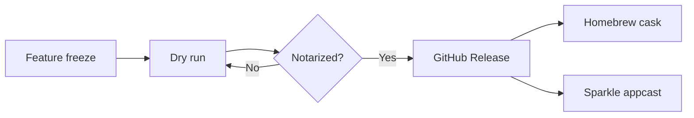

# Launch plan

From the [[2026-11-10 Product sync]]: what ships, and when.



| Milestone | Owner | Date | Status |
| :--- | :--- | :---: | ---: |
| Feature freeze | Luca | Nov 9 | done |
| Dry run of the release | Luca | Nov 11 | done |
| Release 0.3.0 | Anna | Nov 12 | today |
| Landing page | Anna | Nov 13 | next |

> [!warning] Before publishing
> Raise both `MARKETING_VERSION` and `CURRENT_PROJECT_VERSION`: Sparkle compares the build number.

```swift
let updater = SPUStandardUpdaterController(startingUpdater: true,
                                           updaterDelegate: nil,
                                           userDriverDelegate: nil)
```
