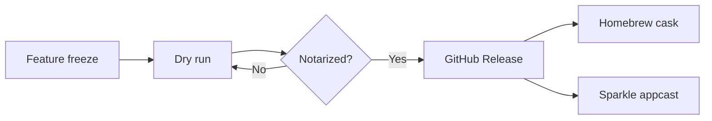

# Launch plan

From the [[2026-11-10 Product sync]]: what ships, and when.



| Milestone | Owner | Date | Status |
| :--- | :--- | :---: | ---: |
| Feature freeze | Luca | Nov 9 | done |
| Dry run of the release | Luca | Nov 11 | done |
| Release 0.4.0 | Anna | Nov 12 | today |
| Landing page | Anna | Nov 13 | next |

> [!warning] Before publishing
> Raise both `version` and `build` in `Cargo.toml`: Sparkle compares the build number.

```rust
fn is_newer(latest: u32, installed: u32) -> bool {
    // Sparkle compares the build, not the version people read.
    latest > installed
}
```
